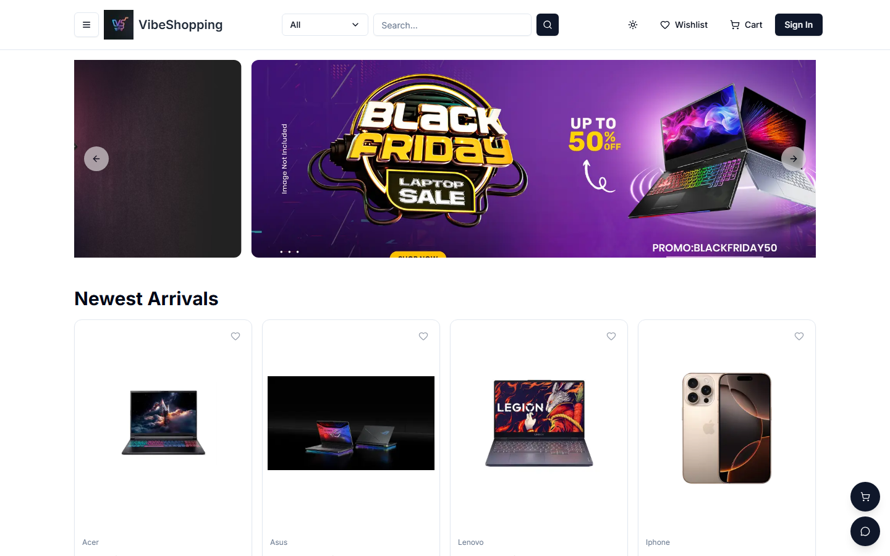
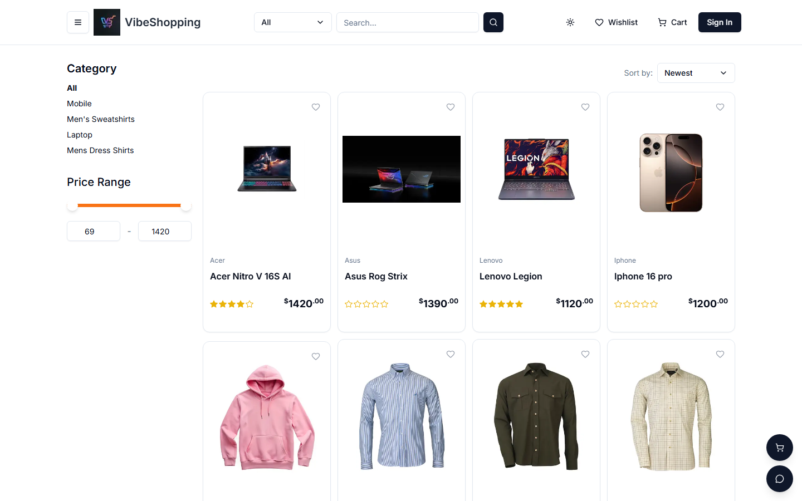
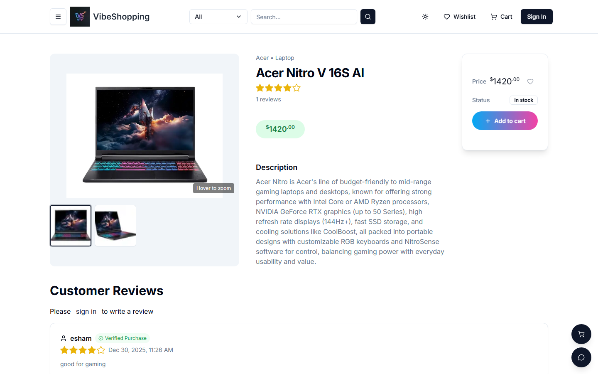
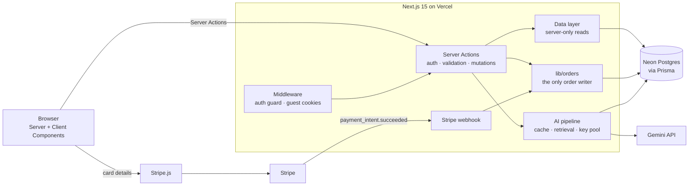
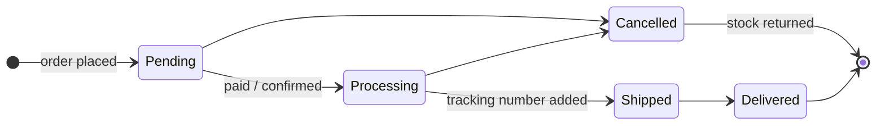

<div align="center">


# VibeShopping

**A full-stack e-commerce platform with an AI shopping assistant grounded in the live catalog.**

Guest-first shopping, Stripe payments verified by webhook, an admin console with sales analytics,<br/>
and a database that defends its own invariants.

[**Live demo →**](https://vibe-shopping-one.vercel.app)


[Features](#features) · [Engineering highlights](#engineering-highlights) · [Architecture](#architecture) · [Getting started](#getting-started) · [Testing](#testing)

</div>

<br/>

<p align="center">
  
</p>

<table>
  <tr>
    <td width="50%"></td>
    <td width="50%"></td>
  </tr>
  <tr>
    <td align="center"><sub>Faceted search: category, price range, rating, sort</sub></td>
    <td align="center"><sub>Product page: image zoom, stock status, verified reviews</sub></td>
  </tr>
</table>

> **Try it:** the demo runs Stripe in test mode. Pay with card `4242 4242 4242 4242`, any future expiry date and any CVC.

---

## Features

**For shoppers**

- **Shop as a guest.** Cart and wishlist work without an account and move into your account when you sign in.
- **Faceted search.** Filter by category, price and rating, with live suggestions as you type. Every filter lives in the URL, so results can be shared and bookmarked.
- **AI shopping assistant.** Ask "gaming laptops under $1500 in stock" or "where is my order?" and get answers built from the live catalog and your own orders.
- **Checkout.** Shipping address, then payment method (Stripe or cash on delivery), then order review.
- **Order tracking.** A status timeline with a timestamped history and tracking number, plus a downloadable PDF invoice.
- **Reviews.** Only customers with a paid order containing the product can review it, and those reviews carry a "Verified Purchase" badge.
- **Sharing and polish.** Shareable cart and wishlist links, light/dark theme, responsive layout.

**For admins**

- **Sales dashboard.** Revenue charts by day, month or year, built from paid orders only.
- **Order fulfilment.** Orders move Pending → Processing → Shipped → Delivered, and invalid moves are rejected by the server.
- **Catalog management.** Image uploads, featured products, and archiving products that have already been sold.
- **User management.** Role-based access, enforced on every server action, not just by hiding the admin pages.

---

## Engineering highlights

These are the parts I'd point an engineer to first.

### 1. An AI assistant that never shows a quota error

The assistant runs on Gemini's free tier, so every message passes through a pipeline whose job is to avoid spending quota, and to degrade gracefully when quota runs out:

| Stage | What it does | Cost |
|---|---|---|
| **Fast path** | Answers greetings, shipping, tax and order-status questions directly from code and the database | 0 tokens |
| **Response cache** | Reuses answers to identical generic questions for 1 hour. Personal questions are never cached, so one customer's order can't be shown to another | 0 tokens |
| **Retrieval** | Pulls matching live products from Postgres (e.g. "under $900" becomes a price filter) and gives them to the model as its only source of truth | 1 SQL query |
| **Rate limit** | Sliding window per visitor (5 per minute, 20 per hour), so one visitor can't use up the day's quota | — |
| **Key-pool failover** | Rotates across several API keys and models. Quota errors (429) put a key and model pair on cooldown; "model not available" errors (404) retire that pair permanently | — |
| **Link guard** | Checks every product link the model writes against the retrieved products and repairs near-miss slugs (edit distance ≤ 3), so a misspelled link never reaches the customer | — |
| **Degraded mode** | If every key is exhausted, answers from the database results alone | 0 tokens |

### 2. Checkout the server is in charge of

- **Prices come from the database, never the browser.** Each line is repriced inside the order transaction, so a tampered request can't change what is charged.
- **No overselling.** Stock is reserved with a conditional `UPDATE … SET stock = stock - qty WHERE stock >= qty`. When two buyers race for the last unit, the second update matches zero rows and that order rolls back.
- **Stripe webhook as the source of truth.** A signature-verified `payment_intent.succeeded` webhook marks orders paid. Payment is recorded idempotently, so retries, duplicate events, and the browser's confirm racing the webhook all result in exactly one write. Creating a payment uses an idempotency key, so reloading the page doesn't create duplicate charges.

### 3. Order history the database itself enforces

- **Every change is an event.** Each status or payment change appends a row to an `OrderEvent` log in the same transaction, and a Postgres trigger blocks editing or deleting those rows. The order timeline is drawn from this log.
- **Status is a real type.** `OrderStatus` is a Postgres enum, and `CHECK` constraints stop the `isPaid` and `isDelivered` flags from ever disagreeing with the status.
- **History is never destroyed.** Orders can't be deleted (a trigger blocks it), and products that have been sold are archived instead, so old invoices and reviews keep pointing at real rows.
- **No lost updates.** Carts and wishlists carry a `version` column. Two quick clicks can't overwrite each other: the later save notices the conflict, reloads, and applies its change again.

### 4. Security by default

- **Every server action checks permissions itself.** Server actions are public endpoints, so each one checks the session and role, and the database is never touched before that check.
- **Reads aren't endpoints.** Read-only queries live in a `server-only` data layer, so they can't be exposed to the browser by accident.
- **A test enforces both.** It calls every exported action as an anonymous visitor and as a regular user, and fails if any is allowed through. New actions are treated as admin-only until explicitly allowed.

---

## Architecture



**Order lifecycle.** Each arrow below writes an `OrderEvent` row:



### Tech stack

| Layer | Technology |
|---|---|
| Framework | Next.js 15 (App Router, Server Components, Server Actions), React 19, TypeScript |
| Database | PostgreSQL on Neon (serverless), Prisma 7 ORM with the Neon driver adapter |
| Auth | Auth.js v5: credentials sign-in, JWT sessions, role-based access |
| Payments | Stripe Payment Intents with a signature-verified webhook |
| AI | Google Gemini with multi-key, multi-model failover |
| UI | Tailwind CSS, Radix UI / shadcn/ui, Framer Motion, Recharts |
| Uploads | UploadThing, restricted to signed-in users |
| Validation | Zod, the single schema source for forms and server actions |
| Testing | Vitest |
| Hosting | Vercel |

### Project structure

```
app/                 routing and page composition only
├── (root)/          storefront: home, search, product, cart, checkout, orders
├── admin/           dashboard, orders, products, users
├── api/             auth, uploads, Stripe webhook
lib/
├── actions/         server actions: the only way to change data, each checks permissions
├── data/            server-only read queries for Server Components
├── ai/              assistant pipeline: retrieval, cache, key pool, link guard
├── orders.ts        order state machine and event log, the only order writer
├── payments.ts      shared idempotent "mark paid" logic
└── auth-guard.ts    requireUser / requireAdmin / requireOrderOwner
prisma/              schema and migrations (enums, triggers, check constraints)
tests/               auth coverage, order-write guard, cart concurrency
```

---

## Getting started

**Prerequisites:** Node.js 20 or newer, a PostgreSQL database ([Neon](https://neon.tech) free tier works), a [Stripe](https://stripe.com) test account and a [Gemini API key](https://aistudio.google.com/apikey).

```bash
git clone https://github.com/EshaAam/VibeShopping.git
cd VibeShopping
npm install          # also generates the Prisma client
```

Create a `.env` file in the project root:

| Variable | Purpose |
|---|---|
| `DATABASE_URL` | Postgres connection string |
| `NEXTAUTH_SECRET` | Session signing secret: `openssl rand -base64 32` |
| `NEXTAUTH_URL` | App URL, e.g. `http://localhost:3000` |
| `NEXT_PUBLIC_SERVER_URL` | Public base URL of the app |
| `GEMINI_API_KEYS` | One or more Gemini keys, comma-separated |
| `STRIPE_SECRET_KEY` / `NEXT_PUBLIC_STRIPE_PUBLISHABLE_KEY` | Stripe API keys (test mode) |
| `STRIPE_WEBHOOK_SECRET` | Webhook signing secret (see below) |
| `UPLOADTHING_TOKEN` | Product image uploads |
| `PAYMENT_METHODS` | Optional, default `Stripe, CashOnDelivery` |

Apply the migrations and start the dev server:

```bash
npx prisma migrate deploy
npm run dev
```

To receive Stripe webhooks locally, run the following and copy the `whsec_…` value it prints into `STRIPE_WEBHOOK_SECRET`:

```bash
stripe listen --forward-to localhost:3000/api/webhooks/stripe
```

## Testing

```bash
npm test
```

| Suite | What it guarantees |
|---|---|
| `action-auth` | Every server action turns away anonymous visitors, and every admin action turns away regular users. A new action without a permission check fails CI. |
| `order-writes` | Order rows are only written through `lib/orders.ts`, so the event log can't be bypassed. |
| `cart-concurrency` | A conflicting cart save reloads and applies its change again instead of overwriting the other one. |

Database guarantees (append-only events, no order deletes, consistent flags) live in the migrations themselves, so they hold even against raw SQL.

---

## Roadmap

- [ ] Move the rate limiter, response cache and key cooldowns to Redis, so they're shared across serverless instances
- [ ] Hybrid product search (Postgres full-text + pgvector) with a retrieval evaluation set
- [ ] AI assistant tool calling, e.g. "add the cheapest one to my cart"
- [ ] Playwright end-to-end tests for checkout
- [ ] Restore archived products from the admin console

---

<div align="center">

Built by **[Ekramul Esham](https://github.com/EshaAam)**


</div>
